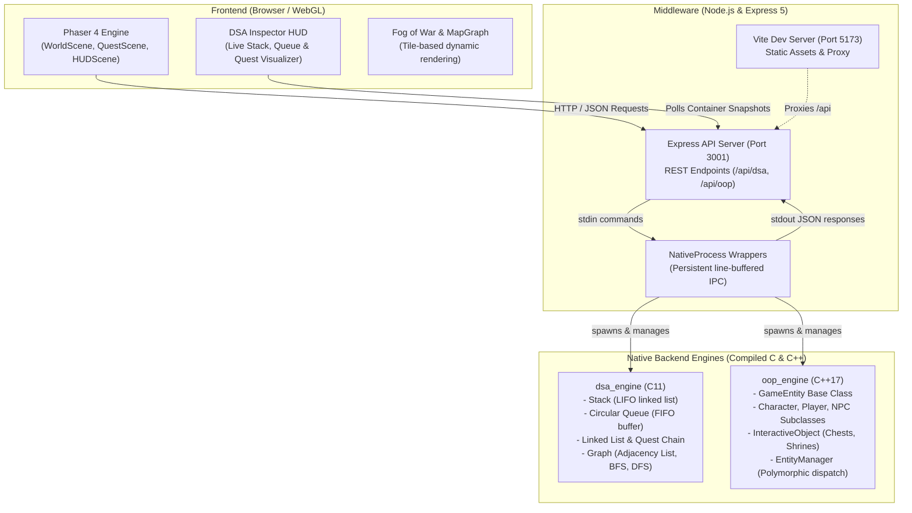

# ⚔️ QuestForge: An Interactive 2D RPG

> **A Free-World 2D RPG Integrating Data Structures, Algorithms, and Object-Oriented Programming**  
> Developed by **SegFault Studios** | Academic Team **DSCPP-III-2026-T227**

[](https://phaser.io/)
[](https://expressjs.com/)
[](https://en.wikipedia.org/wiki/C11_(C_standard_revision))
[](https://en.wikipedia.org/wiki/C%2B%2B17)
[](https://vitejs.dev/)
[](https://nodejs.org/)

---

## 📖 Overview & Motivation

In traditional computer science education, data structures and algorithms are frequently taught through rote memorization, abstract blackboard theory, or competitive coding puzzles devoid of tactile feedback. Concepts like **LIFO stacks**, **circular FIFO queues**, **dynamic linked lists**, **Breadth-First Search (BFS)**, **Depth-First Search (DFS)**, and **Object-Oriented Programming (OOP)** polymorphism often feel disconnected from tangible software systems.

**QuestForge** bridges this educational gap by turning core computer science concepts into active game mechanics within an immersive 2D role-playing game:
- **Action History & Maze Navigation**: Powered by a custom **C Stack** where backtracking pops nodes in real time.
- **Game Event Dispatcher**: Managed by a **C Circular Queue** enforcing FIFO notification toasts.
- **Quest Progression**: Modeled as an in-memory **C Singly Linked List** with rigorous state transitions (`LOCKED` ➔ `AVAILABLE` ➔ `ACTIVE` ➔ `COMPLETED`).
- **Forest Exploration (Lost Path)**: A graph-theoretical maze where the **Guide's Lantern** calculates the optimal path using **BFS**, and the **Scout** explores deeper clearings using **DFS**.
- **Living Entities & Interactions**: Built upon a robust **C++ OOP Entity Hierarchy** (`GameEntity` ➔ `Character` ➔ `Player`/`NPC`, and `InteractiveObject`) with polymorphic `interact()` dispatch.

---

## 👥 Team Information (SegFault Studios)

| Role | Name | Scholar ID | Email | Primary Responsibilities |
| :--- | :--- | :--- | :--- | :--- |
| **Team Lead** | **Anushka Diwaker** | 2510011707 | anushkadiwaker9d@gmail.com | C Stack & Circular Queue, UI Components, DSA Inspector HUD, Quest/NPC Data |
| **Team Member** | **Shobhit Rawat** | 2510013357 | shobhitrawat2150@gmail.com | C++ OOP Entity Hierarchy, OOP Engine, Sprite Extraction Pipeline, Village & Lost Path Maps |
| **Team Member** | **Ashu Khanduri** | 2510012142 | ashukhanduri07@gmail.com | Graph Algorithms (BFS/DFS), C Linked List & Quest Chain, Node.js Middleware Bridge, System Architecture |

---

## 🏛️ System Architecture

QuestForge utilizes a modern **3-Tier Hybrid Architecture** bridging web technologies with native compiled C and C++ engines:



### Communication Protocol
The Node.js server maintains persistent long-running background processes for `dsa_engine` and `oop_engine`. Node writes single-line ASCII command tokens to `stdin` and reads single-line JSON responses from `stdout`. All state remains strictly in native memory between requests, guaranteeing zero serialization lag and direct O(1) pointer updates.

---

## 🎮 Key Features & Game Mechanics

### 1. Village Hub (Exploration & World Interaction)
- Freely roam the village using **WASD** or arrow keys.
- Converse with villagers, the **Elder**, the **Guide**, the **Blacksmith**, and the **Librarian**.
- Inspect interactive world objects: chests, signs, shrines, and doorways.
- Every interaction dynamically dispatches through the C++ `EntityManager` via `virtual interact()`.

### 2. The Lost Path Quest (Graph & BFS/DFS Challenge)
- The Whispering Woods represent an unweighted undirected graph derived directly from the Tiled map clearings (nodes) and forest paths (edges).
- **Fog of War**: Shrouds unexplored clearings until stepped into or revealed.
- **Route Backtracking Stack**: Walking into a clearing pushes its node ID onto the C `route` stack. Backtracking to a previous clearing pops the top node, updating the route visually in real time.
- **Guide's Lantern (`H` Key)**: Invokes **Breadth-First Search (BFS)** in C to highlight the next immediate edge along the shortest path to the Old Shrine.
- **Scout's Vision (`F` Key)**: Invokes **Depth-First Search (DFS)** in C to reveal branches in topological depth order.
- **Post-Quest Comparison**: Upon reaching the Old Shrine, the game plots your actual route side-by-side with the optimal BFS route and DFS traversal tree.

### 3. Live DSA Inspector HUD
- Toggleable HUD panel showing live data structures directly from C memory:
  - **History Stack**: Displays the most recent player actions (newest on top).
  - **Event Queue**: Displays queued game events awaiting notification dispatch.
  - **Quest Chain**: Shows current quest progression through singly-linked list nodes.

---

## 📂 Repository Structure

```
DSCPP-PBL/
├── .gitignore                      # Git exclusion rules
├── CODE_OF_CONDUCT.md              # Contributor Covenant Code of Conduct
├── README.md                       # Project overview & main presentation
├── USAGE.md                        # Setup, execution, and control manual
├── docs/                           # In-depth architectural & technical documentation
│   ├── ARCHITECTURE.md             # 3-Tier engine communication & IPC
│   ├── DATA_STRUCTURES.md          # C implementations of Stack, Queue, Graph, BFS/DFS
│   ├── GAME_MECHANICS.md           # Quest designs, Fog of War, and challenge rules
│   └── OOP_DESIGN.md               # C++ class hierarchy, polymorphism & EntityManager
├── Phase_1/                        # Proposal documents, high-level diagrams, and LaTeX sources
│   ├── High_Level_Diagram.png
│   ├── LaTex_Code_Overleaf.tex
│   └── Phase_1.pdf
└── Project_Code/                   # Complete game source code
    ├── assets/                     # Sprites, tilesets, maps, and audio
    ├── native/                     # Native C and C++ source code & build system
    │   ├── build.mjs               # Node.js compiler script invoking gcc/g++
    │   ├── c/                      # C11 Data Structures & Algorithms
    │   │   ├── bfs.c / dfs.c       # Graph traversal implementations
    │   │   ├── graph.c / graph.h   # Adjacency list graph
    │   │   ├── linked_list.c/.h    # Singly linked list
    │   │   ├── quest_chain.c/.h    # Quest finite state machine
    │   │   ├── queue.c / queue.h   # Circular FIFO queue
    │   │   ├── stack.c / stack.h   # LIFO singly-linked stack
    │   │   └── dsa_engine.c        # Main C service process
    │   └── cpp/                    # C++17 Object-Oriented Entity System
    │       ├── GameEntity.cpp/.h   # Base entity abstraction
    │       ├── Character.cpp/.h    # Character base class
    │       ├── Player.cpp/.h       # Playable character entity
    │       ├── NPC.cpp/.h          # Non-playable characters
    │       ├── InteractiveObject.cpp/.h # Chests, doors, shrines
    │       ├── EntityManager.cpp/.h# Polymorphic entity registry
    │       └── oop_engine.cpp      # Main C++ service process
    ├── scripts/                    # Asset extraction & map generation scripts
    ├── server/                     # Express 5 backend & IPC services
    ├── src/                        # Phaser 4 frontend client (JavaScript ES Modules)
    ├── tests/                      # Automated test suite for native engines & data
    ├── package.json                # Project dependencies & scripts
    └── vite.config.js              # Vite configuration with proxying
```

---

## 🚀 Quick Start Guide

### Prerequisites
- **Node.js**: v20.19.0 or higher
- **C/C++ Compiler**: `gcc` and `g++` on your system `PATH` (MinGW-w64 on Windows, `build-essential` on Linux, Xcode CLI on macOS)

### 1. Installation
Navigate to the `Project_Code` directory and install dependencies:
```bash
cd Project_Code
npm install
```

### 2. Compile Native Engines
Build the native C and C++ executables into `Project_Code/native/bin/`:
```bash
npm run build:native
```

### 3. Launch Development Server
Start both the Express API server and the Vite client simultaneously:
```bash
npm run dev
```
Open your browser at **`http://localhost:5173`** to enter QuestForge!

### 4. Run Automated Test Suite
Verify that all native data structures, OOP dispatchers, and map graphs operate correctly:
```bash
npm test
```

For detailed controls, gameplay strategies, and configuration options, see [USAGE.md](file:///c:/Users/Aryan/Desktop/pbl-utkarsh/USAGE.md).

---

## 📜 Academic Attribution & License

This project was conceived and created for the **Data Structures and Object-Oriented Programming in C/C++ Project-Based Learning (DSCPP-PBL)** curriculum by:
- **Anushka Diwaker** (Lead)
- **Shobhit Rawat**
- **Ashu Khanduri**

Licensed under the [ISC License](file:///c:/Users/Aryan/Desktop/pbl-utkarsh/Project_Code/package.json).
