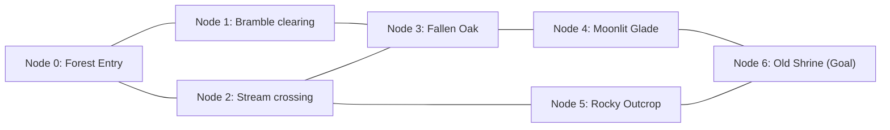

# 🎮 Game Mechanics & Quest Design

QuestForge combines classic top-down 2D RPG exploration with active computer science mechanics. Rather than passively quizzing the player on algorithmic concepts, the game requires the player to utilize those exact concepts to navigate and progress.

---

## 🗺️ 1. Exploration & World Structure

### The Village Hub
The starting area is a bustling medieval village containing:
- **Elder**: Provides overarching lore and advice on virtue and human etiquettes.
- **Guide**: Introduces graph theory and offers the first quest, **"Lost Path"**.
- **Blacksmith**: Forges equipment; accepts ore and metal items.
- **Librarian**: Explains the history of algorithms and stores historical texts.
- **Interactive Objects**: Chests containing gold/potions, an anvil, decorative benches, and town bulletin boards.

Interactions are processed by sending an HTTP POST to `/api/oop/interact`, triggering C++ virtual method execution on the entity matching the player's proximity.

---

## 🌲 2. The "Lost Path" Quest (Graph Theory, BFS, DFS)

### Concept & Lore
A pilgrim went missing in the **Whispering Woods**, a dense forest characterized by a web of clearings connected by overgrown trails. The village Guide commissions the player to find the ancient **Old Shrine**.

### Core Mechanics

#### A. Graph Derivation from Tiled Map
The forest map is defined in Tiled JSON format (`assets/maps/lost_path.json`).
- Clearings are defined in an object layer (`Nodes`).
- Trails connecting clearings are read by `MapGraph.js` and converted into an unweighted graph $G = (V, E)$.
- This exact graph structure is passed over the line-protocol to the C backend engine for real-time pathfinding.

#### B. Dynamic Route Backtracking Stack
- Every time the player steps inside the trigger zone of a clearing (node), its ID is pushed onto the named C stack `'route'`.
- If the player gets lost or reaches a dead end and returns to the previous clearing, the system detects backtracking and executes `stack_pop()`.
- The on-screen route line is redrawn directly from the items remaining in the C stack.

#### C. Guide's Lantern (Breadth-First Search)
- The player starts with 2 charges of the **Lantern** (`H` key).
- Pressing `H` invokes the C `bfs()` algorithm starting from the player's current clearing with the Old Shrine as the target.
- BFS examines all neighbors at distance $d=1$ before exploring distance $d=2$, mathematically guaranteeing the fewest hops.
- The next immediate path forward lights up with glowing particles on the screen.

#### D. Scout's Vision (Depth-First Search)
- The player starts with 1 charge of the **Scout** (`F` key).
- Pressing `F` invokes the C `dfs()` algorithm.
- The scout dashes ahead, exploring one single path as deep as possible before backtracking, uncovering clearings in DFS topological order.

#### E. Fog of War
- Unvisited clearings are completely blacked out by a dynamic canvas-based Fog of War mask.
- Entering a clearing or using the Scout permanently reveals the surrounding clearing zone.

---

## 📊 3. Live DSA Inspector HUD

Pressing **`Tab`** or **`I`** toggles the on-screen **DSA Inspector**:
1. **History Stack Panel**:
   - Shows the top 10 actions stored in C memory (e.g. `TALK:guide`, `ACCEPT_QUEST:lost_path`, `MOVE:village`).
   - Illustrates Last-In-First-Out (LIFO) stack behavior.
2. **Event Queue Panel**:
   - Displays pending game notifications in FIFO order before they are popped and shown as screen toasts.
3. **Quest Chain Panel**:
   - Shows all quests linked in the C singly linked list and their active status (`LOCKED`, `AVAILABLE`, `ACTIVE`, `COMPLETED`).
