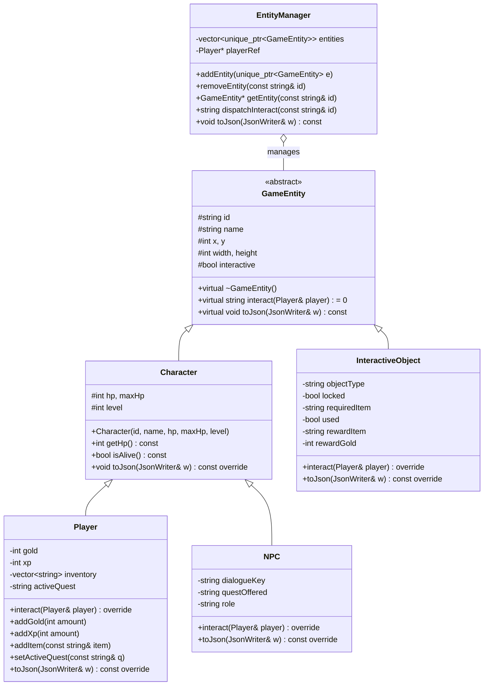

# 🧬 Object-Oriented Programming (OOP) Design

All game entities, behaviors, and world interactions are modeled using standard **C++17** adhering to modern Object-Oriented Programming design principles. The code resides in `Project_Code/native/cpp/`.

---

## 🏛️ Class Hierarchy Diagram



---

## 💎 Core OOP Principles Applied

### 1. Data Abstraction & Encapsulation
- The abstract base class `GameEntity` encapsulates standard spatial parameters (`x`, `y`, `width`, `height`) and common identification metadata (`id`, `name`).
- Internal entity states (like Player HP, Gold, XP, and inventory vector) are kept `private` or `protected`, exposed strictly through public member functions (`addGold()`, `addItem()`, `isAlive()`).

### 2. Inheritance
- `Character` inherits from `GameEntity`, adding health, levels, and alive-status tracking.
- `Player` and `NPC` inherit from `Character`, acquiring common biological statistics while adding specialization:
  - `Player`: Manages gold, experience points, quest state, and inventory.
  - `NPC`: Manages dialogue keys, offered quests, and village occupations.
- `InteractiveObject` inherits directly from `GameEntity`, modeling inanimate interactive world items like treasure chests, ancient shrines, locked doors, and signs.

### 3. Polymorphism & Dynamic Dispatch
- The base class defines the pure virtual method:
  ```cpp
  virtual std::string interact(Player &player) = 0;
  ```
- Each subclass overrides `interact()` with unique domain behavior:
  - **`Player::interact()`**: Returns personal self-status.
  - **`NPC::interact()`**: Unlocks or advances quest dialogue.
  - **`InteractiveObject::interact()`**: Checks if locked, checks player inventory for required keys/items, awards loot (`rewardGold`, `rewardItem`), and transitions state from unused to used.
- The `EntityManager` holds a heterogeneous collection `std::vector<std::unique_ptr<GameEntity>>` and dispatches interactions polymorphically at runtime:
  ```cpp
  std::string EntityManager::dispatchInteract(const std::string &id) {
      GameEntity *e = getEntity(id);
      if (!e) return "{\"ok\":false,\"error\":\"ENTITY_NOT_FOUND\"}";
      return e->interact(*playerRef); // Dynamic dispatch via vtable
  }
  ```

### 4. Memory Safety & RAII
- Entities are owned via smart pointers (`std::unique_ptr<GameEntity>`), guaranteeing automatic resource reclamation without memory leaks.
